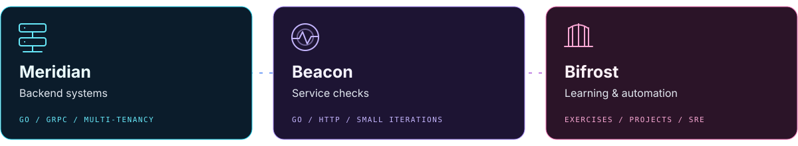
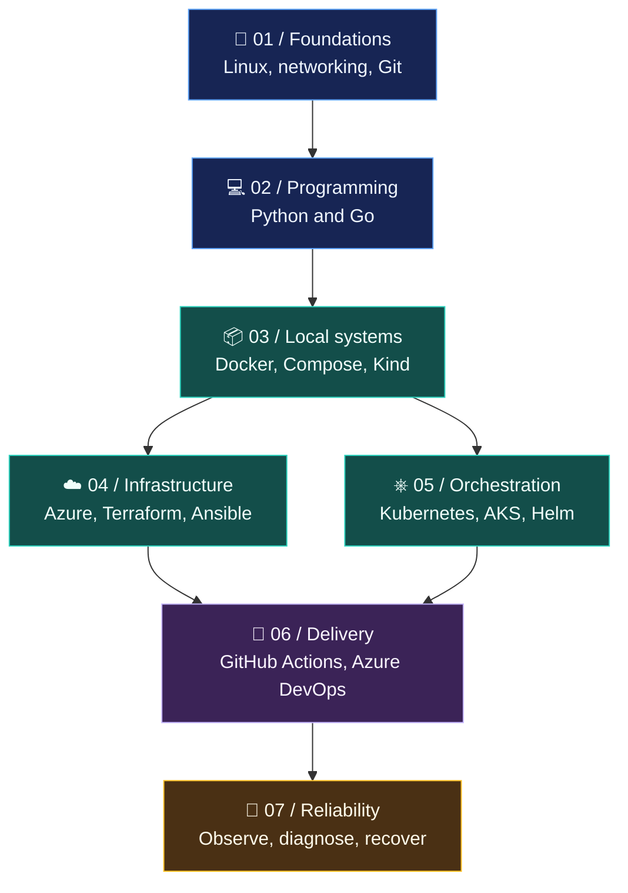

<h1 align="center">Hi, I'm Pruthviraj Sonawane.</h1>

  <strong>Backend systems. Practical automation. Reliability by design.</strong>

  <a href="https://thesyscoder.com">Visit my website</a>
  &nbsp; / &nbsp;
  <a href="#on-the-workbench">Explore the workbench</a>
  &nbsp; / &nbsp;
  <a href="#learning-in-public">Follow the learning map</a>

I build backend projects and learn how to make systems easier to understand, operate, and trust. This is my engineering notebook: small experiments, deliberate practice, and projects that connect the pieces.

## On the workbench

| Project | The idea | Current focus |
| :--- | :--- | :--- |
| **Meridian** | A multi-tenant backend built with Go microservices. | Tenant boundaries, identity, authorization, and reusable service libraries. |
| **Beacon** | A small Go project for learning service availability checks. | Building the prober incrementally, one working concept at a time. |
| **Bifrost** | A structured workspace for automation and SRE learning. | Commented exercises, small projects, and a roadmap from fundamentals to infrastructure. |

These repositories are currently **private**. The descriptions reflect work in progress, not claims of production scale.

## My technical direction

| Area | Tools and concepts |
| :--- | :--- |
| **🩵 Backend projects** | Go, gRPC, PostgreSQL, Redis, Kafka |
| **💜 Automation practice** | Python, Go, shell, Make |
| **🩷 Infrastructure roadmap** | Azure, Terraform, Ansible |
| **💙 Platform roadmap** | Docker, Compose, Kubernetes, AKS, Helm, Kind |
| **🧡 Delivery and reliability roadmap** | GitHub Actions, Azure DevOps, observability, SLOs, runbooks |

**A tool on the roadmap is a learning goal, not a proficiency claim.**

## Learning in public

My approach is simple: understand a concept, write a focused exercise, then use it in a small project.

> **✅ Completed:** Python fundamentals 
> **🧪 Exploring now:** Lists, logic, and loops 
> **🧭 Direction:** From small scripts to systems I can explain and operate

<strong>Open the learning map</strong>

This is a direction of travel, not a completed checklist. I add implementation only as I work through the topics.

<strong>What good practice looks like to me</strong>

- Explain the code instead of just making it run.
- Prefer a small working example over an impressive empty scaffold.
- Separate focused **exercises** from **projects** that combine concepts.
- Make failures understandable and recovery repeatable.
- Keep credentials out of Git and cloud experiments within a budget.
- Document what is implemented, what is being explored, and what is still planned.

<strong>Understand the system. Build with intent. Leave a useful trail.</strong>

Original, self-contained artwork. No tracking widgets, generated contribution activity, or live-status claims. Animations respect reduced-motion preferences.

